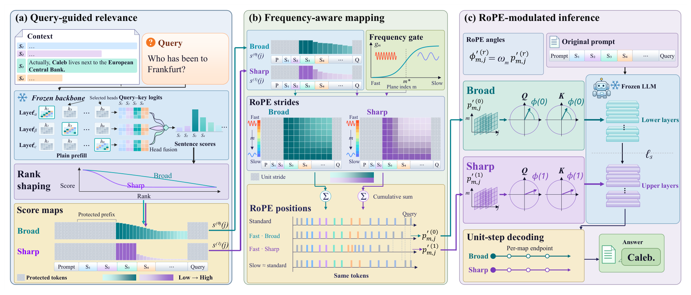

<div align="center">

# **QGPM**:*Query-Guided RoPE Modulation for Lost-in-the-Middle Mitigation in Long-Context LLMs*


A training-free method that reshapes RoPE positions with query relevance from the model's own attention heads, pulling
the evidence a query needs toward it while every token stays in place.

[Overview](#overview) • [Abstract](#abstract) • [Main Results](#main-results) • [Key Features](#key-features) •
[Repository Layout](#repository-layout) • [Datasets](#datasets) • [Setup](#setup) • [Run](#run) •
[Citation](#citation)

</div>

## Overview

<p align="center">
  
</p>

QGPM moves the evidence a query needs closer to that query in RoPE space, in three steps:

1. **Query-guided relevance.** A plain prefill reads the RoPE logits from the query to every context token in a few
   calibrated attention heads. Each context segment (a sentence, or a sentence-aligned chunk on RULER) is scored by its
   strongest token; the scores are standardized per head and averaged over the heads.
2. **Broad and sharp maps.** The ranking of the segments is shaped twice: a broad map guides the lower half of the
   decoder layers and a sharp map the upper half. The context before the first relevant segment is protected.
3. **Frequency-aware strides.** On the fast-rotating planes, low-relevance tokens advance by less than one position,
   while the slow planes keep the original layout. Decoding continues in unit steps from the last prompt position of
   each map.

```
delta_m(j) = max( s(j) + (1 - s(j)) * sigmoid((m - m*) / tau_m), eps )    stride of token j on plane m
p'_{m,j}   = sum_{k=1..j} delta_m(k)                                        remapped position
```

Here `s(j)` in [0, 1] is the relevance of token `j`, plane `m = 0` rotates fastest, `m*` is the plane whose wavelength
equals the anchor length, `tau_m` sets the width of the transition and `eps` is the smallest stride.

## Abstract

Long-context language models often neglect information in the middle of the input, a phenomenon known as
"lost-in-the-middle". Part of this gap may stem from the long-range decay of rotary position embedding (RoPE), which
weakens the positional signal between distant tokens. Existing input compression deletes low-importance tokens, and
attention reweighting acts only after RoPE has weakened this signal. RoPE-level methods modify positions directly but
apply the same remapping to every query. To address these limitations, we propose QGPM (Query-Guided Positional
Modulation), a training-free method that reshapes RoPE positions using query relevance from the model's own attention
heads. QGPM builds a broad relevance map for lower layers and a sharp one for upper layers. Low-relevance tokens advance
by less than one position on fast-rotating planes, pulling relevant evidence toward the query. Slow-rotating planes keep
the original layout, with every token in place. Experiments on NoLiMa and RULER with multiple context lengths show that
QGPM improves over base models and strong baselines, with the largest gains on retrieval tasks, and generalizes across
multiple backbones.

## Main Results

Accuracy (%) averaged over context lengths, NoLiMa at 4K–32K and RULER at 4K–64K. Vanilla is the unmodified backbone
and STRING the strongest baseline. The paper also compares LLMLingua-2, Ms-PoE, Self-Extend, input editing (Top-K,
Reorder) and an Oracle with annotated evidence, and reports every context length.

| Backbone | Method | NoLiMa | QA-1 | QA-2 | NIAH-MK | NIAH-MV | Avg. |
|---|---|---:|---:|---:|---:|---:|---:|
| Qwen2.5-7B | Vanilla | 28.5 | 79.6 | 57.0 | 94.3 | 83.5 | 68.6 |
| | STRING | 33.1 | 79.4 | 57.8 | 92.3 | 76.6 | 67.8 |
| | **QGPM** | 46.1 | 80.4 | 58.0 | 99.4 | 93.4 | **75.4** |
| Qwen3-4B | Vanilla | 16.1 | 77.5 | 56.6 | 99.6 | 96.0 | 69.2 |
| | STRING | 22.9 | 78.8 | 60.0 | 99.3 | 93.0 | 70.8 |
| | **QGPM** | 25.1 | 80.1 | 56.2 | 99.6 | 96.8 | **71.6** |
| Ministral-8B† | Vanilla | 11.5 | 73.5 | 59.0 | 89.4 | 91.4 | 65.0 |
| | STRING | 17.1 | 73.3 | 59.1 | 94.7 | 90.8 | 67.0 |
| | **QGPM** | 24.1 | 73.6 | 59.0 | 95.2 | 93.4 | **69.1** |
| Granite-3.3-8B | Vanilla | 18.6 | 78.6 | 62.7 | 66.0 | 71.1 | 59.4 |
| | STRING | 25.9 | 78.8 | 62.9 | 73.5 | 75.8 | 63.4 |
| | **QGPM** | 35.6 | 78.8 | 63.1 | 85.1 | 78.9 | **68.3** |

† Includes 64K, which exceeds the 32,768-token window configured for Ministral-8B.

## Key Features

- **Training-free.** No fine-tuning and no new parameters; QGPM patches the RoPE of a Hugging Face model at inference
  time.
- **Query-specific positions.** The relevance comes from the backbone's own calibrated heads, so each query gets its own
  position layout instead of one fixed remapping.
- **Every token in place.** Nothing is deleted or reordered: only the fast-rotating planes are compressed, and the slow
  planes keep the original layout.
- **Layer-wise maps.** A broad map guides the lower layers and a sharp map the upper layers.
- **Low overhead.** One extra plain prefill that stops after the deepest selected layer; decoding cost and KV cache size
  stay those of standard inference.
- **Four backbones.** Calibrated heads and scripts for Qwen2.5-7B-Instruct-1M, Qwen3-4B-Instruct-2507,
  Ministral-8B-Instruct-2410 and granite-3.3-8b-instruct; `tools/` calibrates a new one.
- **Oracle analysis.** The same RoPE modulation driven by the gold evidence instead of the head relevance.

## Repository Layout

```
main.py                   entry point: python3 main.py <NoLiMa|RULER> <Base|QGPM|Oracle> [flags]
config.py                 flags, per-dataset defaults, run names
runners.py                model loading and the run loops
QGPM/                     the method
    attn_scorer.py        segment relevance from the calibrated heads, shaped into score maps
    rank_transform.py     rank transform of the relevance into scores
    chunker.py            sentence-aligned segmentation of the context
    region.py             which part of the context a map may compress
    token_map.py          alignment of context characters with prompt tokens
    rope.py               frequency-aware RoPE with one score map per decoder layer
    oracle.py             gold-evidence scores
    scorer.py             scorer interface
    score_cache.py        SQLite cache of the relevance
pipeline/                 data, prompts, generation and evaluation
scripts/                  experiment scripts, one per backbone and benchmark
heads/                    calibrated head rankings, one per backbone
ruler/                    RULER patch and data generation
tools/                    RoPE checks, head calibration, GPU job queue
assets/                   figures
Dockerfile.hf, Makefile   Docker image
```

## Datasets

[NoLiMa](#nolima) • [RULER](#ruler)

The data are not part of this repository; both benchmarks go to `Datasets/`. Generating RULER needs the environment
from [Setup](#setup).

### NoLiMa

We use the needle set and the five `rand_shuffle` haystack books of [NoLiMa](https://github.com/adobe-research/NoLiMa):

```bash
HF=https://huggingface.co/datasets/amodaresi/NoLiMa/resolve/main
wget -P Datasets/NoLiMa/data/needlesets $HF/needlesets/needle_set.json
for i in 1 2 3 4 5; do
    wget -P Datasets/NoLiMa/data/haystack/rand_shuffle $HF/haystack/rand_shuffle/rand_book_$i.txt
done
```

The needle placements (58 tests × 26 depths × 5 books per context length) are built on first use and cached in
`Log_placements/`. All backbones read the same placements.

### RULER

RULER is generated rather than downloaded, and our code needs two fields that the original generator does not write:
`haystack`, the context embedded in each prompt, and `evidence`, the supporting sentences of the QA tasks (used by the
Oracle). `ruler/prepare.sh` clones [NVIDIA/RULER](https://github.com/NVIDIA/RULER) at commit `ab17b78`, applies
`ruler/ruler.patch`, which adds these fields and leaves the original ones unchanged, downloads the source texts with
RULER's own scripts and generates the four tasks at 4K–64K with 500 samples each:

```bash
pip install nltk wonderwords html2text beautifulsoup4 tenacity pyyaml
bash ruler/prepare.sh
```

Lengths are counted with the Qwen2.5 tokenizer, and every backbone reads the same files
(`Datasets/RULER/qwen/<task>/<length>/validation.jsonl`); each backbone's chat template is applied at run time.

| Paper | QA-1 | QA-2 | NIAH-MK | NIAH-MV |
|---|---|---|---|---|
| RULER task | `qa_1` | `qa_2` | `niah_multikey_3` | `niah_multivalue` |

## Setup

[Option 1: Micromamba](#option-1-micromamba) • [Option 2: venv](#option-2-venv) • [Option 3: Docker](#option-3-docker)

The experiments ran with Python 3.10, PyTorch 2.8 (CUDA 12.8), Transformers 5.5.0 and flash-attn 2.8.3 on NVIDIA A100
GPUs.

### Option 1: Micromamba

```bash
micromamba create -n QGPM -c conda-forge python=3.10 -y
micromamba activate QGPM
pip install torch==2.8.0 --index-url https://download.pytorch.org/whl/cu128
pip install -r requirements.txt
pip install https://github.com/Dao-AILab/flash-attention/releases/download/v2.8.3/flash_attn-2.8.3+cu12torch2.8cxx11abiFALSE-cp310-cp310-linux_x86_64.whl
```

### Option 2: venv

```bash
python3.10 -m venv .venv
source .venv/bin/activate
pip install torch==2.8.0 --index-url https://download.pytorch.org/whl/cu128
pip install -r requirements.txt
pip install https://github.com/Dao-AILab/flash-attention/releases/download/v2.8.3/flash_attn-2.8.3+cu12torch2.8cxx11abiFALSE-cp310-cp310-linux_x86_64.whl
```

### Option 3: Docker

`Dockerfile.hf` builds the same environment. The image holds no code or data: mount the repository, with `Datasets/`,
at run time.

```bash
docker build -f Dockerfile.hf -t qgpm:hf .
docker run --gpus all -it --rm \
    -v "$PWD":/workspace/app \
    -v ~/.cache/huggingface:/workspace/.cache/huggingface \
    qgpm:hf
```

Results, caches and downloaded models stay on the host.

## Run

[Quick Start](#quick-start) • [Reproducing the Paper](#reproducing-the-paper) • [Adding a Backbone](#adding-a-backbone)

### Quick Start

```bash
# QGPM on NoLiMa at 16K
python3 main.py NoLiMa QGPM --model_name_or_path Qwen/Qwen2.5-7B-Instruct-1M --context_length 16000

# Vanilla on RULER QA at 32K
python3 main.py RULER Base --model_name_or_path Qwen/Qwen2.5-7B-Instruct-1M --context_length 32k --tasks qa_1 qa_2

# Oracle: gold evidence instead of the head relevance, same RoPE modulation
python3 main.py RULER Oracle --model_name_or_path Qwen/Qwen2.5-7B-Instruct-1M --context_length 16k \
    --tasks niah_multivalue
```

The interface is `python3 main.py <NoLiMa|RULER> <Base|QGPM|Oracle> [flags]`, where `Base` is the Vanilla backbone;
`python3 main.py NoLiMa QGPM --help` lists all flags. The defaults are the general settings of each benchmark, and
`scripts/` holds the per-backbone settings of the paper. Results go to `Results/<run name>/`: one JSON file per haystack
or task with every answer and its score, and `summary.json` with the averages. An interrupted run resumes where it
stopped.

For a quick check, `--haystacks rand_book_1.txt --test_ids 0402` (NoLiMa) or `--max_records 5` (RULER) runs a small
subset; give such runs their own `--results_dir`, since a run resumes into an existing directory.

### Reproducing the Paper

Each script runs Vanilla and QGPM on one backbone over all context lengths, with the settings for that backbone:

```bash
bash scripts/Qwen2.5-7B-Instruct-1M_nolima.sh
bash scripts/Qwen2.5-7B-Instruct-1M_ruler.sh
bash scripts/Qwen3-4B-Instruct-2507_nolima.sh
bash scripts/Qwen3-4B-Instruct-2507_ruler.sh
bash scripts/Ministral-8B-Instruct-2410_nolima.sh
bash scripts/Ministral-8B-Instruct-2410_ruler.sh
bash scripts/granite-3.3-8b-instruct_nolima.sh
bash scripts/granite-3.3-8b-instruct_ruler.sh
```

Extra flags are passed on to every run, e.g. `bash scripts/Qwen3-4B-Instruct-2507_ruler.sh --results_dir Results_qwen3/`.

### Adding a Backbone

QGPM needs a ranking of the backbone's attention heads. Check the RoPE patch on the new model, collect per-head
signals on NoLiMa and rank the heads:

```bash
CUDA_VISIBLE_DEVICES=0 python3 tools/check_identity.py --model <model>
CUDA_VISIBLE_DEVICES=0 python3 tools/collect_attn_signals.py --model <model> --out signals/<model>
python3 tools/calibrate_heads.py --signals signals/<model> --out heads/<model>.txt
```

`check_identity.py` verifies that all-ones scores reproduce the unmodified model exactly and that decoding continues
the remapped positions. The heads are ranked by the mean reciprocal rank of the needle on NoLiMa 8K.

## Citation

```bibtex
@misc{QGPM2026,
  title  = {Query-Guided RoPE Modulation for Lost-in-the-Middle Mitigation in Long-Context LLMs},
  author = {Anonymous},
  year   = {2026},
  note   = {Under review}
}
```

## Acknowledgements

The benchmarks come from [NoLiMa](https://github.com/adobe-research/NoLiMa) and
[RULER](https://github.com/NVIDIA/RULER). We thank their authors for releasing the data and code.
